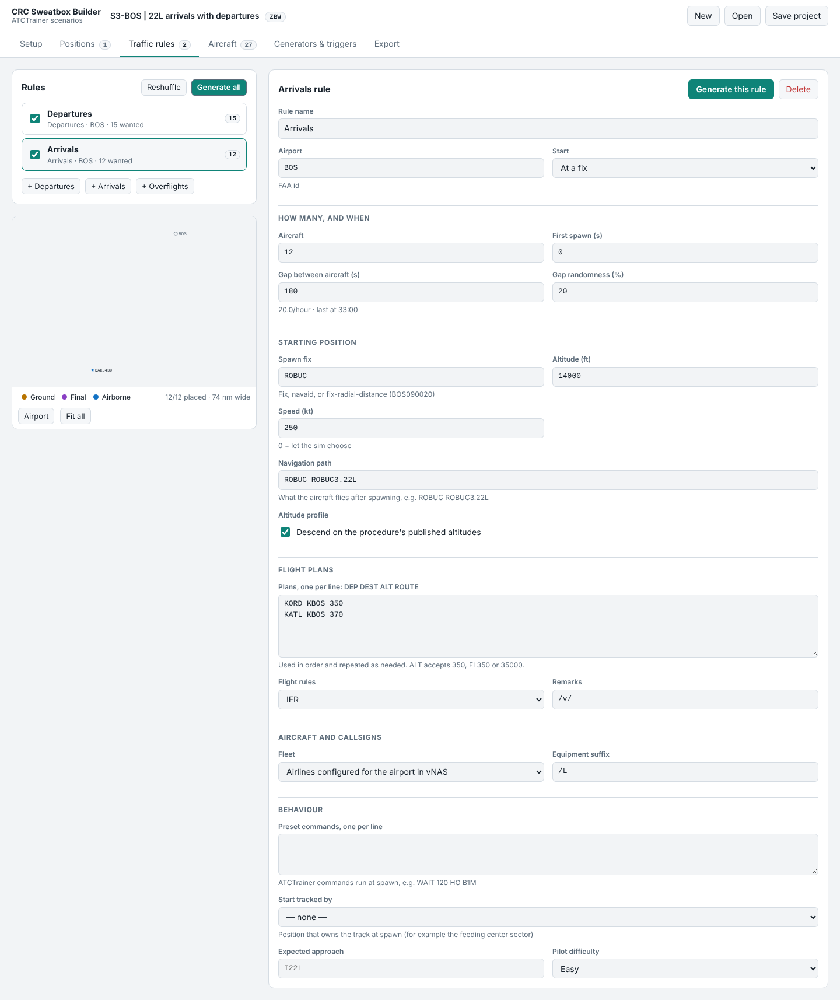
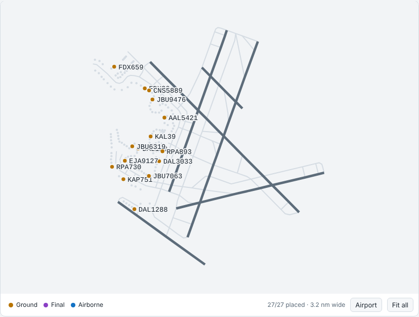

# CRC Sweatbox Builder

A web app for building **vNAS ATCTrainer** training scenarios, the scenarios
that fly the traffic you control in **CRC** on the sweatbox servers.

**Use it now: https://grandparex.github.io/crc-sweatbox-builder/**

Describe traffic as rules ("15 departures from the A and B gates", "an arrival
every 3 minutes over ROBUC at 14,000 on the ROBUC3"), generate it, tweak
individual aircraft, and export scenario JSON in the exact shape vNAS uses.



## Quick start

1. **Setup** — pick your ARTCC and click **Load facility from vNAS**. Load the
   vNAS nav database too if you want fix checking and the map. Name the
   scenario, set the primary airport and the student position.
2. **Positions** — add the simulated controllers around the student.
3. **Traffic rules** — add departure, arrival or overflight rules, then
   **Generate all**.
4. **Aircraft** — review the result in the table and on the map; edit anything
   by hand.
5. **Export** — fix any reported problems, then download the scenario JSON.

Your work autosaves in the browser. **Save project** writes a `.project.json`
(scenario + rules) you can reopen later or share.

## Features

| Tab | What it does |
| --- | --- |
| **Setup** | Data loading, scenario name, primary airport, student position. Can start from any published vNAS scenario. |
| **Positions** | Simulated controller positions, auto-connect and auto-track airports. |
| **Traffic rules** | Streams of traffic for ground/tower (gates, runway, final), approach (fixes and STARs) and enroute (boundary fixes at cruise). |
| **Aircraft** | Every aircraft in a table and on a map. Add, edit, duplicate, delete. |
| **Generators & triggers** | ATCTrainer's built-in arrival generators and scenario-wide commands such as `SQALL`. |
| **Export** | Validation, JSON download, and the Data Admin push snippet. |

How generation behaves:

- **Repeatable.** The same rules give the same traffic until you press
  **Reshuffle**.
- **Hand edits are safe.** Editing a generated aircraft detaches it from its
  rule, so regenerating never overwrites it.
- **No clashes.** Gates and callsigns are never reused within a scenario.
- **Real data.** Gates come from the airport's vNAS ground map and airlines
  from the fleet configured for that airport in vNAS.



## Where the data comes from

Navigation data (fixes, airports, runways, SIDs/STARs) is resolved in order:

1. **Sector files you load** — `.sct` / `.sct2` (airports, fixes, VORs, NDBs,
   runways) and `.ese` (SIDs and STARs).
2. **vNAS nav database** for anything the sector files don't cover.

Controller positions, gate names and airline fleets **always** come from vNAS.
A scenario refers to positions by vNAS id and to gates by the names on the
vNAS airport map, so a sector file can't supply them.

You can also drop vNAS files in by hand on the Setup page instead of loading
them over the network: an ARTCC JSON (`/api/artccs/ZBW`), an airport map
(`/api/training/airports/BOS/map`), the training airport list
(`/api/training/airports`) and `/Files/NavData.dat`, all from
`data-api.vnas.vatsim.net`.

## Getting a scenario into vNAS

vNAS Data Admin has **no scenario file import**; its documentation says
scenarios cannot be modified externally. The Export tab offers what other
community tools do: a short console snippet that, run on a scenario's page in
Data Admin while you are logged in, saves your scenario over that one using
the same request the Save button sends.

This is unofficial, has no undo, and has not been tested against a real Data
Admin account. Create an empty scenario to receive it rather than overwriting
real work, and check with your facility's training staff before using it.

## Running locally

Needs Node.js 18 or newer.

```bash
npm install
```

```bash
npm run dev
```

Then open http://localhost:5180.

| Command | What it does |
| --- | --- |
| `npm run dev` | Dev server with hot reload |
| `npm test` | Unit tests |
| `npm run build` | Type-check and build into `dist/` |
| `npm run preview` | Serve the production build |

If `npm install` warns that esbuild's install script was blocked and the dev
server then fails to start, run `npm install-scripts approve esbuild` followed
by `npm rebuild esbuild`.

## How the vNAS connection works

The vNAS data API does not allow calls from a web page on another site, so
the app never calls it directly. It goes through a small read-only forwarder:

- **Locally**, `npm run dev` and `npm run preview` forward `GET /vnas/*`
  themselves (see `vite.config.ts`). Nothing to set up.
- **On the hosted site**, a Cloudflare Worker does the forwarding
  (`proxy/worker.js`). Its address is built in at deploy time, so visitors
  have nothing to configure.

The Worker only answers `GET` requests, only for the vNAS endpoints the app
uses, and only for pages served from the site named in its `SITE` setting.

## Deploying your own copy

The repo deploys to GitHub Pages on every push to `main`
(`.github/workflows/pages.yml`).

1. **Pages:** in the repo, set **Settings → Pages → Source** to
   **GitHub Actions**.
2. **Worker:** create a Cloudflare Worker, paste in `proxy/worker.js`, set
   `SITE` at the top to your Pages address (for example
   `https://yourname.github.io`), and deploy. Opening
   `<worker address>/api/artccs/ZBW` should show JSON.
3. **Secret:** in the repo, add an Actions secret named `VNAS_BASE` whose
   value is the Worker address, with no trailing slash
   (**Settings → Secrets and variables → Actions**).
4. **Push** to `main` and wait for the Actions run to finish.

With the secret set, the hosted build uses the Worker and hides the connection
setting. Without it, the site still works but shows a **vNAS connection**
field on the Setup page where a forwarder address can be entered by hand.

The secret keeps the address out of the repository, but it is not truly
private: any site's network requests can be seen in the browser's developer
tools. The Worker's restrictions above are what protect it.

## Project layout

```
src/core    schema types, traffic generator, validation, geo, ids
src/data    vNAS client and parsers, nav database decoder, sector files
src/state   app store (project autosave, data loading)
src/ui      pages, map preview, form widgets
proxy       Cloudflare Worker that forwards vNAS requests for the hosted site
tests       unit tests and fixtures (a real vNAS scenario and airport map)
```

## Credits

Scenario format and data come from [vNAS](https://virtualnas.net). Inspired by
[Sweatbox-Builder](https://github.com/FlyingfrogFR/Sweatbox-Builder),
[SaunaSim](https://github.com/sauna-sim/sauna-ui) and
[sb_scenario_generator](https://github.com/frazerxyz/sb_scenario_generator).
Not affiliated with VATSIM or vNAS.
